### Hi, I'm Philipp

I build developer tools in Python, and have done UI/UX on many stacks since 2012:
Kodi (160 merged PRs to its C++ core, plus Python add-ons and templated skin markup), Qt desktop
apps, web, terminal UIs and editor extensions. Today most of it flows into **[agentpool](https://github.com/phil65/agentpool)**,
an experimental hub that connects AI agents over ACP and MCP.
These days my AI agents maintain the whole stack: they plan, delegate tasks to other agents, run
the releases, sweeps, docs and reviews, and I steer.

<picture>
  <source media="(prefers-color-scheme: dark)" srcset="assets/timeline-dark.svg">
  <source media="(prefers-color-scheme: light)" srcset="assets/timeline-light.svg">
  
</picture>

<picture>
  <source media="(prefers-color-scheme: dark)" srcset="assets/ecosystem-dark.svg">
  <source media="(prefers-color-scheme: light)" srcset="assets/ecosystem-light.svg">
  
</picture>

<details>
<summary>Mermaid source</summary>

```mmd
block-beta
  columns 3
  block:serves["Serves"]:1
    columns 2
    Zed Toad OpenCode acptui
  end
  hub["agentpool ★201<br/>agents of every kind<br/>in one YAML file<br/>ACP · MCP · AG-UI"]
  block:perf["Performance: Rust in Python"]:1
    columns 2
    ripgrep_rs["ripgrep-rs"] sublime_search["sublime-search"] frizbee_rs["frizbee-rs"] mermaid_rs["mermaid-rs"]
  end
  block:proto["Protocols & agent backends"]:1
    columns 2
    aclientp clawd_code_sdk["clawd-code-sdk"] codexed pyt3client llmling_models["llmling-models"] tokonomics
  end
  block:tools["Tools & execution"]:1
    columns 2
    exxec docler searchly evented anyvoice
  end
  block:prompt["Prompting & UI"]:1
    columns 2
    promptantic slashed toprompt jinjarope clinspector
  end
  block:found["Foundation"]:2
    columns 5
    anyenv upathtools schemez epregistry yamling
  end
  block:docs["Docs toolchain"]:1
    columns 1
    mknodes["mknodes<br/>builds agentpool's docs"]
  end
  serves --> hub
  hub --> perf
  hub --> proto
  hub --> tools
  hub --> prompt
  proto --> found
  tools --> found
  docs --> found
  class serves cyan
  class hub hub
  class perf orange
  class proto violet
  class tools blue
  class prompt amber
  class found emerald
  class docs pink
```

</details>

#### Featured

| Project                                                                                                                  | What it is                                                                              |
| ------------------------------------------------------------------------------------------------------------------------ | --------------------------------------------------------------------------------------- |
| [agentpool](https://github.com/phil65/agentpool)                                                                         | Agents of every kind in one YAML file, served over ACP, MCP, AG-UI and OpenCode         |
| [mknodes](https://github.com/phil65/mknodes)                                                                             | Build Markdown documentation in Python from composable, project-aware nodes             |
| [aclientp](https://github.com/phil65/aclientp) · [acptui](https://github.com/phil65/acptui)                              | Agent Client Protocol for Python (typed v1 and draft v2), and a terminal UI built on it |
| [upathtools](https://github.com/phil65/upathtools) · [jinjarope](https://github.com/phil65/jinjarope)                    | Filesystem toolkit for fsspec / universal-pathlib; Jinja2 toolkit                       |
| [mmd-viz](https://github.com/phil65/mmd-viz) · [framesheet](https://github.com/phil65/framesheet)                        | Mermaid to zero-JS animated SVG; frame-accurate contact sheets of animated SVGs         |
| [PrettyQt](https://github.com/phil65/PrettyQt)                                                                           | Pythonic wrapper for PyQt6 / PySide6                                                    |
| [script.extendedinfo](https://github.com/phil65/script.extendedinfo) · [Estuary](https://github.com/phil65/skin.estuary) | Kodi add-on with extended media info; Kodi's default skin                               |

<details>
<summary>GitHub metrics</summary>


</details>

<sub>The timeline is an approximation based on the repositories I maintain today; many older packages were deleted, archived or renamed.<br>
README built with [mknodes](https://github.com/phil65/mknodes) · ecosystem diagram rendered from Mermaid with [mmd-viz](https://github.com/phil65/mmd-viz) · timeline drawn by [`scripts/generate.py`](scripts/generate.py) · all from [`data/profile.toml`](data/profile.toml).</sub>
