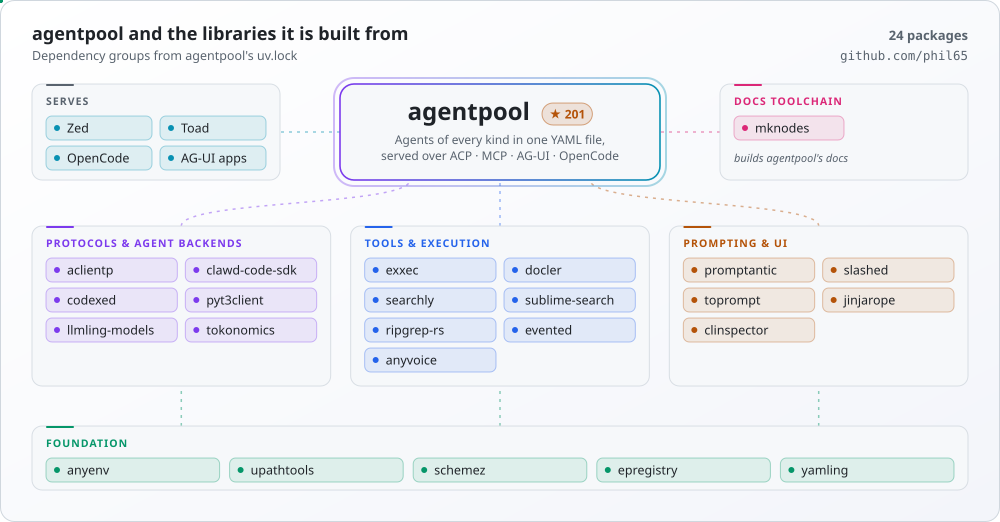

### Hi, I'm Philipp

I build developer tools in Python, and have done UI/UX on many stacks since 2012:
Kodi (160 merged PRs to its C++ core, plus Python add-ons and templated skin markup), Qt desktop
apps, web, terminal UIs and editor extensions. Today most of it flows into **[agentpool](https://github.com/phil65/agentpool)**,
an experimental hub that connects AI agents over ACP and MCP.

<picture>
  <source media="(prefers-color-scheme: dark)" srcset="assets/timeline-dark.svg">
  <source media="(prefers-color-scheme: light)" srcset="assets/timeline-light.svg">
  
</picture>

<picture>
  <source media="(prefers-color-scheme: dark)" srcset="assets/ecosystem-dark.svg">
  <source media="(prefers-color-scheme: light)" srcset="assets/ecosystem-light.svg">
  
</picture>

#### Featured

| Project | What it is |
|---|---|
| [agentpool](https://github.com/phil65/agentpool) | Agents of every kind in one YAML file, served over ACP, MCP, AG-UI and OpenCode |
| [mknodes](https://github.com/phil65/mknodes) | Build Markdown documentation in Python from composable, project-aware nodes |
| [aclientp](https://github.com/phil65/aclientp) · [acptui](https://github.com/phil65/acptui) | Agent Client Protocol for Python (typed v1 and draft v2), and a terminal UI built on it |
| [upathtools](https://github.com/phil65/upathtools) · [jinjarope](https://github.com/phil65/jinjarope) | Filesystem toolkit for fsspec / universal-pathlib; Jinja2 toolkit |
| [mmd-viz](https://github.com/phil65/mmd-viz) · [framesheet](https://github.com/phil65/framesheet) | Mermaid to zero-JS animated SVG; frame-accurate contact sheets of animated SVGs |
| [PrettyQt](https://github.com/phil65/PrettyQt) | Pythonic wrapper for PyQt6 / PySide6 |
| [script.extendedinfo](https://github.com/phil65/script.extendedinfo) · [Estuary](https://github.com/phil65/skin.estuary) | Kodi add-on with extended media info; Kodi's default skin |

GitHub metrics

The timeline is an approximation based on the repositories I maintain today; many older packages were deleted, archived or renamed. Graphics are generated from [`data/profile.toml`](data/profile.toml) by [`scripts/generate.py`](scripts/generate.py).
